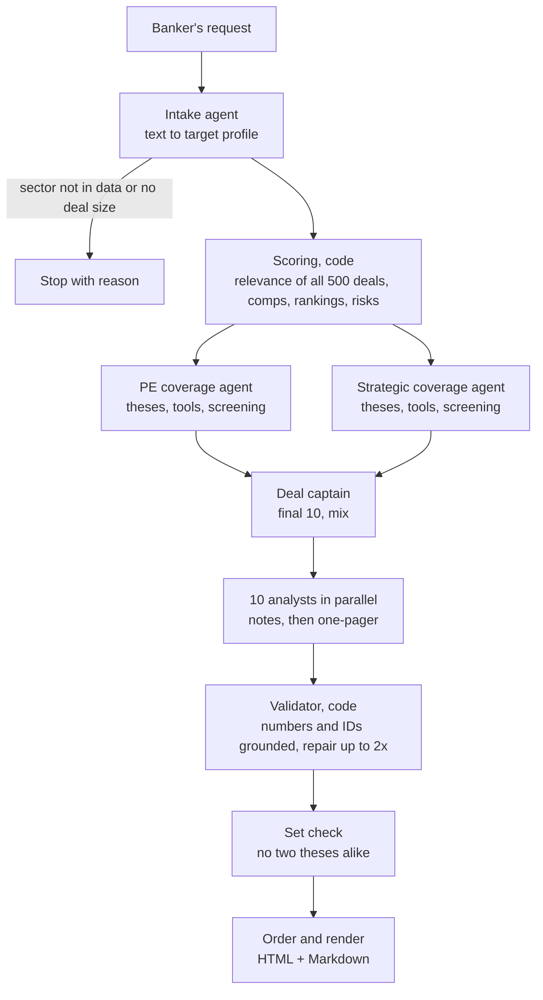

# Acquirer Engine

An agentic engine that answers a sell-side banker's question: **"Who are the 10 most likely acquirers for this company, and why?"**

Give it a request in plain English (by default: *a $200M healthcare services company, mid-market, private, regional, strong EBITDA margins*). It reads 500 past healthcare M&A transactions, finds the precedents that look like this deal, works out who did them, and has a small team of agents screen and pick the ten most likely buyers. It then writes a one-page rationale for each: acquirer overview, strategic fit thesis, precedent activity, valuation context, risk flags and conviction.

**See the output first:** [`sample_output/report.html`](sample_output/report.html) (open in a browser; prints one page per buyer) or [`sample_output/report.md`](sample_output/report.md).

| | |
|---|---|
| Runtime | ~40–50 s per live run (budget: 55 s) |
| Model calls | ~26 per run (Claude Haiku 5.5 and Sonnet 5.5) |
| Cost | ~$0.50 per live run; **$0 and no key** to replay the recorded run |
| Tests | 185, all run without an API key |

---

## Contents

1. [Quick start](#1-quick-start)
2. [How it works](#2-how-it-works)
3. [The method, step by step](#3-the-method-step-by-step)
4. [The agents](#4-the-agents)
5. [Prompt design](#5-prompt-design)
6. [How the data is used](#6-how-the-data-is-used)
7. [Assumptions](#7-assumptions)
8. [Reliability: validation, repair, fallbacks, time budget](#8-reliability-validation-repair-fallbacks-time-budget)
9. [Non-determinism and the replay cache](#9-non-determinism-and-the-replay-cache)
10. [Observability](#10-observability)
11. [Testing](#11-testing)
12. [Limitations and failure modes](#12-limitations-and-failure-modes)
13. [With more time](#13-with-more-time)
14. [Project layout and configuration](#14-project-layout-and-configuration)
15. [Demo](#15-demo)

---

## 1. Quick start

### No API key: replay the recorded run (Docker)

```bash
docker build -t acquirer-engine .
docker run --rm -v "$PWD/runs:/app/runs" acquirer-engine run --mode replay
```

PowerShell: use `-v "${PWD}/runs:/app/runs"`. The full report appears in `runs/<timestamp>/` in about a second. Every model answer comes from the recording in [`replay_cache/`](replay_cache/), so the result matches [`sample_output/`](sample_output/).

### Live run (Docker)

```bash
export ANTHROPIC_API_KEY=sk-ant-...          # PowerShell: $env:ANTHROPIC_API_KEY = "sk-ant-..."
docker run --rm -e ANTHROPIC_API_KEY -v "$PWD/runs:/app/runs" acquirer-engine
```

### Without Docker (Python 3.12+)

```bash
python -m venv .venv
source .venv/bin/activate                     # Windows: .venv\Scripts\activate
pip install -e ".[dev]"
cp .env.example .env                          # then put your key in .env, without quotes
acquirer-engine run                           # live, the default request
acquirer-engine run --mode replay             # no key needed
acquirer-engine run --text "a founder-owned $150M dental chain in the Midwest"
pytest                                        # 185 tests, no key needed
```

Running live without a key stops with a clear message pointing to `--mode replay`.

### Modes

| `--mode` | Reads stored answers | Calls the API | Stores answers | Use |
|---|---|---|---|---|
| `live` (default) | yes | when not stored | yes | normal runs |
| `replay` | yes (the recording, by default) | never | no | no key; repeats the recorded run |
| `refresh` | no | always | yes, overwriting | re-record |
| `off` | no | always | no | a fresh run that leaves no trace |

Other options: `--text "..."` (any request), `--cache PATH` (another answer store), `--strict` (stop on unexpected errors instead of falling back).

### What a run writes

```
runs/<timestamp>/
  report.html       cover summary, one printable page per buyer, appendix
  report.md         the same report in Markdown
  run_report.json   status and seconds per step, tokens per agent, fallbacks, what the agents changed
  state.json        everything each step produced
  run.log           every step, model call, retry, repair and fallback as one JSON line
```

---

## 2. How it works

The design rule is simple: **code owns every number; agents own judgment.** Scoring, valuation, risks and conviction are deterministic Python that can be tested against known answers. Agents decide what to look at, who fits, who to pick and how to explain it, and code checks everything they say against the data.



| Step | Who | Model | What it decides |
|---|---|---|---|
| Intake | agent | Haiku 5.5 | Turns free text into a target profile, quoting the words behind every field; stops if the request can't be run |
| Scoring | code | none | Relevance of every past deal, valuation comps, buyer rankings, risk signals, conviction rule |
| PE coverage | agent | Sonnet 5.5 | Which sponsors belong in the pool, which to screen out, and why |
| Strategic coverage | agent | Sonnet 5.5 | Which operating companies belong in the pool, judging *what each buyer is* |
| Deal captain | agent | Sonnet 5.5 | The final 10 and the PE/strategic mix |
| Analyst ×10 | agent | Sonnet 5.5 | Plans, then writes, each one-pager |
| Validator, set check, order, render | code | none | Checks, repairs, ordering and the report |

The plain ranking is the screen; the agents are the bankers. The screen guarantees no strong candidate is missed; the agents decide who actually fits and say why. The report shows every difference between the agents' list and the plain ranking, with the reason (see [sample output](sample_output/report.md), "What the agents changed").

---

## 3. The method, step by step

### Step 1: define the target

The request becomes a `TargetProfile` in the dataset's own terms: sector, enterprise value, ownership, region, margin band. Fields not stated stay empty and are left out of the comparison; nothing is guessed. Revenue and EBITDA, if not given, are **estimated** from peers (same sector, same margin band): for the default target, 16 peers give revenue ≈ $84.4M and EBITDA ≈ $15.0M. The estimates describe the target only; they are never used to score deals.

### Step 2: score every past deal for relevance

Each of the 500 deals gets seven factor weights between 0 and 1, multiplied together:

> relevance = sector × size × deal type × ownership × margin × geography × recency

Read it as *"how much of a perfect precedent is this deal."* Multiplying means a big miss (wrong sector, very different size) drags the score down hard, while small misses only trim it.

How each factor is calculated, and the judgment values behind it (all in `config.yaml` → `scoring`):

| Factor | How it's calculated | Judgment values (`config.yaml`) |
|---|---|---|
| **Sector** | Target's own sector = 1.0. For any other sector X: take every buyer with a deal in the target's sector; *share* = fraction of their other-sector deals that fall in X; *base* = fraction of all other-sector deals that fall in X; *lift* = share ÷ base (1.0 = no pattern). Weight = `sector_mult × lift`, clipped to `[sector_floor, sector_cap]`. Computed from the data at run time. | `sector_mult: 0.5`, `sector_floor: 0.1`, `sector_cap: 0.9` |
| **Size** | `doublings = abs(log2(deal size ÷ target EV))`, so half and double the target's size are equally far. Weight = `max(size_base ^ doublings², size_floor)`. | `size_base: 0.8` (2× or ½× counts 80%), `size_floor: 0.05` |
| **Deal type** | Looked up by the deal's type in a tier table: whole-company control deals score highest. | `deal_type_tiers` (control deals 1.0; recap, minority, carve-out 0.6; SPAC, merger of equals 0.3) |
| **Ownership** | 1.0 if the deal's target had an owner type in the target's ownership list, else the miss weight. Neutral (1.0) if ownership isn't stated. | `ownership_miss: 0.7` |
| **Margin** | Each deal's margin = EBITDA ÷ revenue. Within each sector, the median and a high percentile split deals into weak / medium / strong bands. Weight depends on how many bands the deal sits from the target's band: 0 → 1.0, 1 → medium weight, 2 → weak weight. Neutral if the target's margins aren't stated. | `margin_strong_percentile: 0.65`, `margin_medium: 0.85`, `margin_weak: 0.7` |
| **Geography** | Neutral (1.0) when no region is stated. Otherwise 1.0 for deals in the same region or marked National / Multi-Regional, the miss weight for other single regions. | `geography_miss: 0.7` |
| **Recency** | Age = latest year in the data − deal year. Weight from a step table; anything older gets the old-deal weight. | `recency_steps` (0–1 yrs 1.0, 2–3 yrs 0.9, 4–6 yrs 0.75), `recency_old: 0.6` |

Every deal is scored whatever its outcome: a withdrawn deal still shows what the buyer wanted.

### Step 3: valuation context

The 20 most relevant **closed** deals form the comps table. For the default target: **EV/Revenue 2.49x** (middle half 2.01–3.01x); PE buyers 2.49x, strategics 2.38x. EV/EBITDA is shown both calculated (16.59x) and as stated in the data (12.00x); section 6 explains why.

### Step 4: rank buyers, separately by type

PE firms and strategic buyers have very different deal histories in this data: the 15 PE firms average about 19 deals each, the 92 strategics about 2. A single ranking would bury every strategic. So:

- **PE firms**: score = sum of the three most relevant deals (0–3). Their deal counts are similar, so "how good are your best matches" is a fair comparison.
- **Strategics**: average deal relevance **shrunk toward the strategic average** (empirical Bayes). With one or two deals, a single lucky deal shouldn't outrank a pattern. The data decides how skeptical to be (about 11 "pretend deals" at the group average): Oscar Health's one deal at 0.52 becomes (0.52 + 11 × 0.114) / 12 ≈ **0.149**, with a 90% range showing how uncertain that is.

### Step 5: risk flags

Six signals, each measured from the buyer's own deals and compared with **buyers of the same type** (PE with PE, strategic with strategic). A risk is flagged when the buyer is in the worst 25% of its type. Risks are grouped the way a seller weighs a bid:

| Lens | Question | Risks (signal) |
|---|---|---|
| Value | Will they pay up? | Price discipline (median EV/Revenue paid) |
| Certainty | Will it close? | Financing (leverage share, or typical deal under half our size), execution (share withdrawn or terminated), antitrust (strategics with 2+ deals in our sector), integration (share of deals far from our sector) |
| Speed | Can they move fast and win? | Auction experience (average bidders), time to close (median days) |

Every page shows at least two risks; if fewer were flagged, the buyer's next-weakest signals appear as "watch" items, not alarms.

### Step 6: conviction

Willingness × ability, the standard way to size up a buyer:

- **Willingness** is High with at least two strong precedents (relevance ≥ 0.4), the latest from 2021 or later.
- **Ability** is High when at most one Value/Certainty/Speed risk was flagged.
- High × High → High; Low × Low → Low; otherwise Medium. The analyst may move it by one level only, with a reason the validator checks.

### Step 7: the final list

The captain picks 10 (default 6 PE, 4 strategic; may shift by one with a written reason; never fewer than 3 of a type). Code orders them so conviction never rises down the list (then by number of strong precedents, then best deal).

---

## 4. The agents

### Intake
Reads the banker's text. Policy is fixed in the prompt, not left to the model: "private" means privately held (private or PE-backed); "regional" means one region but doesn't say which, so region stays empty; "strong margins" means the top 35% of the sector. Every filled field must cite the exact words it came from, and code checks each quote appears in the request. A sector outside the data, or no deal size, stops the run with a clear reason.

### PE and strategic coverage
Two agents with separate prompts and **type-locked tools**: the PE agent's tools can only ever see PE firms and their deals, the strategic agent's only strategics. No tool takes a buyer-type argument, so the agent can't ask for the other type.

| Tool | Returns |
|---|---|
| `search_deals(filters)` | Matching deals, grouped by buyer: count, best relevance, top deal IDs, rank |
| `get_acquirer_profile(name)` | Deal history: size, sectors, deal types, tags, top deals; for strategics also the sector it buys most (an inference) |
| `get_buyer_rankings(top_k)` | The type's ranking with scores (and uncertainty ranges for strategics) |

Each agent works from **seed theses**, banker stories written as deal searches (filters scale with the target's size):

| Thesis | Story |
|---|---|
| P1 Platform builders | Sponsors that buy a company like ours as a platform, then add on |
| P2 Add-on acquirers | Sponsors that already own a business in this space and would bolt ours on |
| P3 Roll-up players | Sponsors consolidating a fragmented market |
| S1 Health systems expanding services | Hospital systems buying services businesses |
| S3 Consolidators cross-selling | Provider platforms buying adjacent services to cross-sell |

The seeds run in code before the agent's first turn. In **turn 1** the agent asks for whatever tools it needs (profiles of borderline buyers, refined searches), all at once; code runs them. In **turn 2** it returns its pool, with the theses each candidate fits, removals with reasons and deal IDs, and a log of every thesis. Screening rules: remove buyers whose strong deals are non-control, outside the target's sector family, or far from our size; for strategics, judge what the buyer *is* (a device maker whose relevant deals are device buyouts does not fit a services target). In the sample run the strategic agent removed Medtronic and Oscar Health on that basis without being told their names.

### Deal captain
One call. Sees both pools and picks the final 10, preferring buyers that cover different theses (ten distinct angles, not ten versions of one story). Every pick needs a reason and its own deal IDs.

### Analysts
One per buyer, all ten in parallel, two steps each:
1. **Notes** (plan): the thesis, the deals to feature, the numbers to cite with their location in the evidence pack, the risks to feature, any conviction adjustment.
2. **Write**: the six sections, from the notes and the pack.

Each analyst receives an **evidence pack** built by code: the buyer's profile, its five most relevant deals with the factor breakdown, the comps, what it has paid, its risks with counts and deal IDs, the conviction rule's result, the theses that surfaced it, the coverage and captain notes, and data caveats (for example, a strategic buyer labelled on leveraged buyouts).

---

## 5. Prompt design

- **Every model answer is structured.** Each call returns a Pydantic model through the model's own structured-output feature. Schemas avoid free-form objects (a `dict` field would let the model return only `{}`), and a test checks every schema for that.
- **Reason, then write.** The analyst plans before writing, and the writing call sees its own plan.
- **Facts versus prose.** The model writes prose only. Precedent and comps tables are built by code from the data, so table numbers are right by construction.
- **Numbers are copied, never computed.** The evidence pack spells out every number a page may use, counts included ("4 of 17 deals withdrawn"). The prompt says to copy them (rounding is fine) and never to add, subtract or divide.
- **Rules state the policy exactly.** For example, the analyst prompt states the conviction rule with its thresholds, so the stated reasons match the real ones; the write prompt says a deal factor below 1.0 is a partial match ("adjacent sector", not "same sector").
- **Fit is a hypothesis.** Intent is inferred from behaviour ("their pattern suggests…"), never stated as fact.
- **No boilerplate.** Phrases like "leading", "well-positioned" or "proven track record" are banned (the list is in `config.yaml`), with one generic and one specific example in the prompt.
- **General knowledge is labelled.** Anything not from the data (for example, "Medtronic is a device maker") must go in a `public_knowledge` list and is shown as such in the report.
- **Prompts are versioned files** in [`src/acquirer_engine/agents/prompts/`](src/acquirer_engine/agents/prompts/); the first line is the version, part of every cached answer's key. Thresholds and banned phrases are filled in from the config, so prompt and code can't drift apart.

---

## 6. How the data is used

The CSV is the only data source: 500 transactions, 2015–2024, 107 acquirers, 10 healthcare sectors.

**Findings that shaped the design (all from the data):**

- **Revenue-based figures are internally consistent; EBITDA-based ones are not.** Deal size ÷ revenue matches the stated EV/Revenue on every deal. But deal size ÷ EBITDA often disagrees with the stated EV/EBITDA, and EBITDA ÷ revenue with the stated margin, by roughly 20–25% at the median. So all math uses our own calculated multiples and margins, **EV/Revenue is the primary valuation anchor**, and EV/EBITDA is always shown both ways (calculated vs stated). Pages flag deals where the two differ by more than 25%.
- **The buyer mix is skewed:** 290 deals by 15 PE firms, 210 by 92 strategics. That is why buyers are ranked within their own type, and why the final list has a guaranteed strategic share.
- **Margins are judged within each sector.** On dataset-wide cut-offs, no Healthcare Services deal would count as "strong" (the sector's median is 14.5%). Within the sector, strong means ≥ 16.0%.
- **Adjacent sectors are weighted, not filtered.** Lift measures which sectors our sector's buyers also buy in, so Physician Groups deals count far more than Health IT deals, and every deal still counts a little.
- **One tag says nothing:** "Geographic Expansion" is on about 90% of deals, so it is left out of buyer profiles.
- **Every deal is used.** Nothing is filtered out; weights decide how much each deal counts. Only the comps table is limited to closed deals, because a withdrawn deal's price was never paid.

---

## 7. Assumptions

| Assumption | Why |
|---|---|
| "Private" covers both privately held owner types (private and PE-backed) | Both are private companies; public and non-profit sales are different processes |
| "Regional" means one of the eight single regions, but not which | Not stated, so geography is left neutral rather than guessed |
| "Strong margins" means the top 35% of the target's own sector | Sector-relative, as above |
| The seller is selling 100% of the company | So whole-company control deals are the best precedents |
| ~$200M means the size curve is centred on $200M, with half or double counting 80% | Size matters in proportion, not dollars |
| Recency is measured from 2024, the latest year in the data | The data ends there |
| A buyer's intent is inferred from its past deals | The data records what buyers bought, not their strategy; fit is stated as a hypothesis |
| "Mid-market" adds nothing beyond the $200M figure | It's a size label, and the exact size is already known |

---

## 8. Reliability: validation, repair, fallbacks, time budget

**Every agent answer is checked by code** before it's used, and errors go back to the model as specific instructions:

| Agent | Checks |
|---|---|
| Intake | Every field's quote appears in the request; exactly one of target or stop reason |
| Coverage | Every candidate and removal appeared in this run's tool results; every deal ID exists and belongs to that buyer; ranks match the ranking; every thesis logged |
| Captain | Picks come from the pools; the mix is 6/4 ± 1 with at least 3 of each; a changed mix has a reason; deal IDs belong to the buyer |
| Analyst | Every number in the prose is in the evidence pack (at the precision written); every deal ID is in the pack; risks match the pack's risks; conviction within one level of the rule, in the direction the notes planned; no banned phrases; 300–500 words |
| Set check | No two fit theses read alike (TF-IDF similarity); the lower-ranked page is rewritten once if time allows |

**Repair:** a failed answer goes back with its errors (up to two repairs per page, one per other agent).

**Fallbacks:** if an agent is unavailable, out of time, or still wrong after repairs, a rule-based result takes its place and the run continues:

| Agent | Fallback |
|---|---|
| Intake | The configured default target (only for the default request; anything else stops) |
| Coverage | The ranking's top 8 of that type |
| Captain | The default 6/4 mix in ranking order |
| Analyst | An evidence-only page assembled from the pack, marked **"needs review"** |

**Time budget:** the whole run has 55 seconds. Each step's deadline is the earlier of its own limit and the time left, so a slow step makes later steps fall back instead of running over. Retries (rate limits, server errors, dropped connections) wait 0.5 s, then 1 s, and only start if there is time to finish.

Unexpected errors (bugs, not model problems) raise in tests and with `--strict`; otherwise they are logged at ERROR, fall back, and are flagged in the report.

---

## 9. Non-determinism and the replay cache

- Current Claude models no longer accept a temperature setting, so two live runs can differ in wording, and **borderline picks can change** between runs (for example, which of two near-equal health systems takes the last strategic seat). Every number comes from code, so numbers never vary for the same picks.
- **Repeatability comes from the answer cache.** Every model request is reduced to a SHA-256 key over everything that shapes the answer (model, settings, prompts with their version, messages including tool results, tool and output schemas). The same request returns the stored answer. Only answers that passed schema validation are stored.
- **The recorded run** in [`replay_cache/`](replay_cache/) was made by a single live run inside Docker. `--mode replay` reproduces it with no key, and a test checks the replay matches [`sample_output/report.md`](sample_output/report.md).
- **Cross-platform stability:** numerical libraries can differ in the last digit between operating systems (one uncertainty range came out as `…285225` on Windows and `…28522` on Linux), which would change a prompt and miss the cache. Numbers in prompts are rounded to six decimals, so the recording replays identically on Windows, macOS and Linux.

---

## 10. Observability

- **`run.log`**: one JSON line per event: each step's start, end and duration; every model call with its tokens, attempts and seconds; retries, repairs and fallbacks with their reasons; a fingerprint of each analyst's evidence pack.
- **`run_report.json`**: per step, status and seconds; tokens by agent and by call type (input, output, prompt-cache reads; cache hits counted separately, so replays show zero new tokens); coverage pools, removals, tool calls and thesis logs; what the agents changed from the plain ranking.
- **The report's appendix** shows the comps, each coverage agent's thesis log and removals, the general knowledge used in screening, and the run's timings and tokens.

---

## 11. Testing

`pytest` runs 185 tests with no API key and no network:

| Layer | What it proves |
|---|---|
| Scoring | Known answers from a hand-checked run: margin cut-offs (14.5% / 16.0%), lift (Physician Groups 1.77), the best precedent (MA-2021-0195 at 0.83), comps (2.49x), shrinkage (mean 0.114, k ≈ 10.7), the full pre-agent list and its conviction levels |
| Tools and schemas | Type lock, seed thesis results, schema rules, no free-form objects in any model-facing schema |
| LLM client | Cache keys, all four modes, retries (429, 529, dropped connection), no retry on a bad request, deadlines, the exact request sent (structured output, no temperature) |
| Agents | Each agent with a scripted fake model: happy path, invented buyer or number caught and repaired, fallback |
| Graph | The whole run with a fake model: stop on an unsupported request, API down (finishes on fallbacks), one agent failing alone, unexpected errors contained or raised, set check |
| Report | One page per buyer with all six sections; table numbers equal the data; fallback pages carry the review banner |
| Replay | The recorded run reproduces the sample report |

---

## 12. Limitations and failure modes

- **Intent is inferred, not known.** The data records what buyers bought, not what they plan. Fit statements are hypotheses from behaviour.
- **Thin strategic evidence.** Most strategics have one to three deals; their scores carry wide uncertainty, and conviction for strategics is usually Medium or Low by construction.
- **No buyer identity data.** The data doesn't say what a buyer *is*. A buyer's most frequent target sector serves as a proxy, and general knowledge is allowed only when labelled.
- **Some guardrails are prompt-only.** Coverage agents are told to keep refined searches within the target's sector family; code validates every candidate they put forward, but doesn't block an off-family search itself.
- **Unlabelled outside claims can't be detected in code.** The validator checks every number and deal ID, but a general-knowledge statement written into the prose without the label would pass.
- **Data labels can be noisy.** Some combinations look synthetic (PE firms on "merger of equals" deals, strategics on leveraged buyouts). Pages carry a caveat where it matters.
- **EBITDA-based figures are unreliable in this data** (section 6); EV/Revenue carries the valuation.
- **Timing.** Typical runs take 40–50 s against a 55 s budget. On a slow API day, the last steps may fall back; a page then ships marked "needs review" rather than the run failing.
- **Weights are expert judgment.** Factor weights and thresholds are banking priors, not learned: the data has no "buyer passed" examples to learn from. All of them are named settings in `config.yaml`.
- **Scope.** Built and tested for the default target. The pipeline is parameterised by the request (any sector, size, ownership or region in the data), but other targets have not been evaluated, and the strategic theses are written for provider services.

---

## 13. With more time

- **Tracing:** OpenTelemetry spans per step and model call, viewable in a trace UI (the logs already carry everything needed).
- **Backtesting the weights:** hide each buyer's latest relevant deal and check whether the engine would have ranked it highly.
- **Stronger writing model:** try Claude Opus for the analyst step and compare page quality against runtime.
- **Arbitrary targets:** evaluate other sectors and sizes, add a state-to-region lookup, and widen the strategic theses beyond provider services.
- **Prompt caching:** move the shared target and comps into the cached system prompt, to cut cost and latency across the ten analysts.

---

## 14. Project layout and configuration

```
config.yaml                every weight, threshold, model setting and time limit, each explained
data/                      ma_transactions_500.csv
src/acquirer_engine/
  cli.py                   acquirer-engine run
  config.py                loads and validates config.yaml
  data.py                  allowed values, Deal and TargetProfile models, CSV loader and checks
  scoring/                 relevance, valuation, buyers (rankings), risk (signals, conviction)
  evidence.py              runs the scoring once; builds each buyer's evidence pack
  tools.py                 type-locked coverage tools, seed theses
  schemas.py               what every agent must return
  llm.py, cache.py         one LLM client: structured answers, retries, deadlines, tokens, answer cache
  agents/                  intake, coverage, captain, analyst, and their prompts/
  validate.py              page checks and the set check
  graph.py                 the LangGraph run: steps, deadlines, fallbacks
  run.py, render.py        writes the run folder and the report; templates/ holds the HTML and Markdown
tests/                     185 tests, no key needed
sample_output/             the report from the recorded run
replay_cache/              the recorded run (model answers), for --mode replay
Dockerfile                 Python 3.12, pinned versions from requirements.lock
```

**Stack:** Python 3.12, LangGraph, LangChain (Anthropic), Pydantic, Typer, Jinja2, structlog, pandas/SciPy, SQLite, pytest.

**Configuration:** every judgment call is a named setting in [`config.yaml`](config.yaml), with a comment saying what it means, what its value means, and which part of the code reads it. Changing one (for example, the strong-precedent threshold) needs no code change. The API key is read from the environment or a local `.env` file and is never stored in the repository.

---

## 15. Demo

Recorded walkthrough: *(link to be added)*
